# COPC Adapter

<p align="center">
  <a href="https://www.npmjs.com/package/@frillab/copc-adapter"></a>
  <a href="https://github.com/mors119/copc-adapter/actions/workflows/ci.yml"></a>
  <a href="https://mors119.github.io/copc-adapter/"></a>
  <a href="https://github.com/mors119/copc-adapter/blob/main/LICENSE"></a>
  <a href="https://github.com/mors119/copc-adapter/releases"></a>
</p>

<p align="center">
  <strong>Stream and visualize COPC point clouds directly in CesiumJS and Three.js.</strong><br>
  The direct adapters need no renderer-specific conversion; an optional experimental 3D Tiles pipeline is available too.
</p>

<p align="center">
  <a href="https://mors119.github.io/copc-adapter/playground/"><strong>Try the Live Playground</strong></a>
  · <a href="https://mors119.github.io/copc-adapter/">Documentation</a>
  · <a href="https://www.npmjs.com/package/@frillab/copc-adapter">npm</a>
</p>

<p align="center">
  <a href="https://mors119.github.io/copc-adapter/playground/"></a>
</p>

## Visual Examples

The CesiumJS captures use the local Autzen Stadium COPC sample.

### Styling Modes

<table width="100%">
  <tbody>
    <tr>
      <td width="33.33%" align="center"><strong>RGB</strong><br>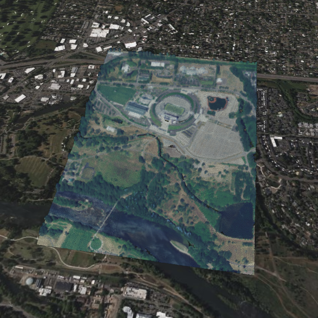<br>Original color attributes.</td>
      <td width="33.33%" align="center"><strong>Elevation</strong><br>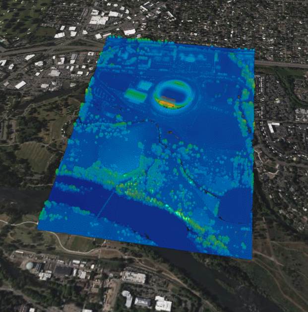<br>Height-based coloring.</td>
      <td width="33.33%" align="center"><strong>Intensity</strong><br>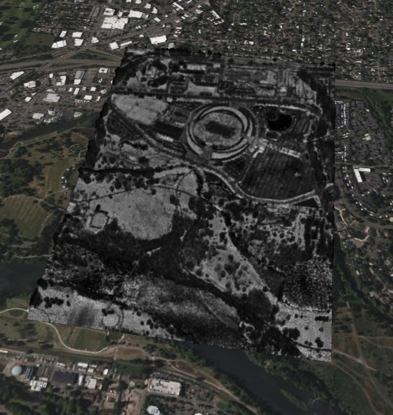<br>Reflected intensity values.</td>
    </tr>
    <tr>
      <td width="33.33%" align="center"><strong>Classification</strong><br>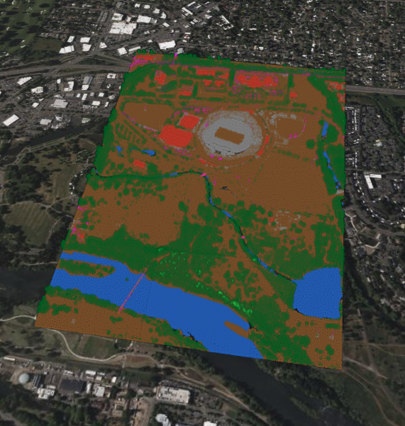<br>LAS classification codes.</td>
      <td width="33.33%" align="center"><strong>Numeric Dimension</strong><br><br>Numeric field color mapping.</td>
      <td width="33.33%" align="center"><strong>Fixed</strong><br>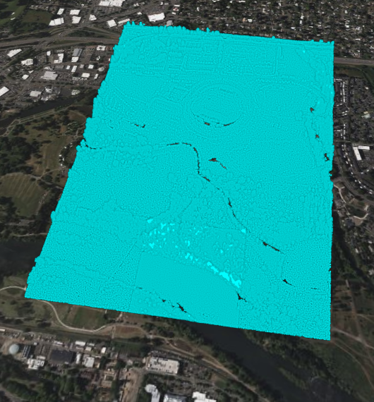<br>Constant color.</td>
    </tr>
  </tbody>
</table>

Attribute-based styles depend on fields available in the dataset and support
in the selected backend. Rust/WASM supports standard LAS `Intensity` but
rejects Extra Bytes requests.

The supported modes are:

- `fixed`: stable cyan fallback color
- `rgb`: source RGB channels
- `elevation`: transformed dataset height range
- `intensity`: normalized intensity range
- `classification`: categorical classification palette
- `dimension`: an explicit numeric LAS dimension range and color ramp

Attribute-based modes fall back to the fixed color when the required source
attribute is unavailable. Cesium layers retain intensity, classification, and
RGB attributes so `setStyle()` can switch modes or apply classification and
numeric range filters from cached point buffers without fetching point chunks
again. Classification filters accept LAS codes from `0` through `255`; points
without a classification value are hidden while a filter is active. Use
`classificationFilter: null` to clear a classification filter.

Numeric dimension coloring accepts standard LAS `Intensity` on both built-in
backends and supported scalar Extra Bytes through `copc-js`. Extra Bytes are
opt-in and count toward the point cache:

```ts
const layer = new CopcCesiumLayer({
  url: 'https://example.com/data.copc.laz',
  colorMode: 'dimension',
  dimension: {
    name: 'CanopyHeight',
    range: { min: 0, max: 50 },
  },
  dimensionFilter: { name: 'CanopyHeight', min: 2, max: 40 },
});
```

The style's dimension is loaded automatically; add `extraDimensions` for
additional fields you want to inspect or switch to later. Numeric values clamp
to the ramp ends, NoData/non-finite values use fixed cyan, and a dimension
filter hides missing or out-of-range values. `copc-js` supports scalar signed
and unsigned 8-, 16-, and 32-bit integers plus 32-/64-bit floats for numeric
styling. 64-bit integer values remain exact for picking but cannot be styled as
JavaScript numbers.

### Camera-Driven LoD and Streaming

<table width="100%">
  <thead>
    <tr>
      <th width="50%">Distant / coarser view</th>
      <th width="50%">Closer / finer view</th>
    </tr>
  </thead>
  <tbody>
    <tr>
      <td align="center">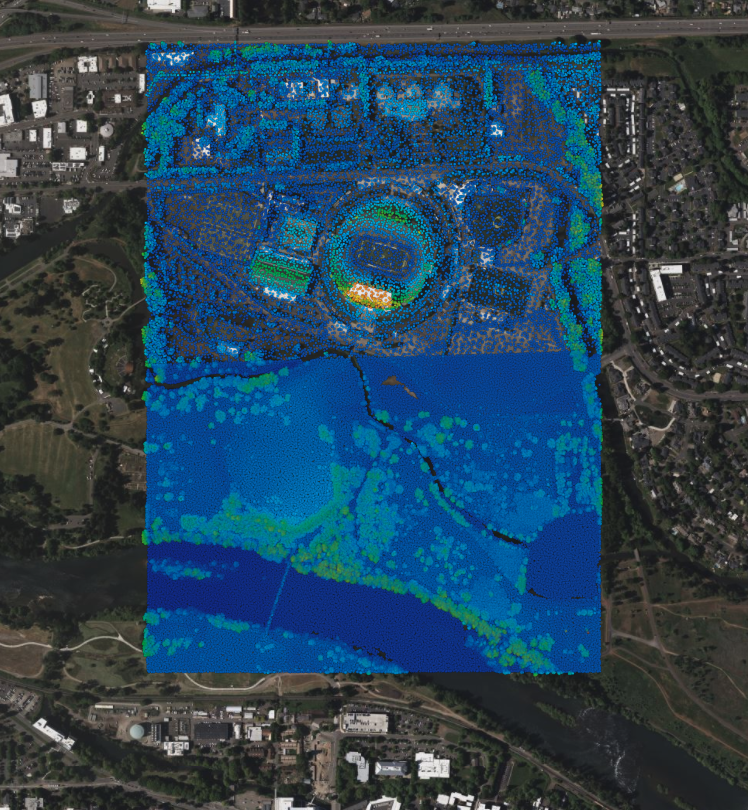<br>Distant view with coarser detail.</td>
      <td align="center">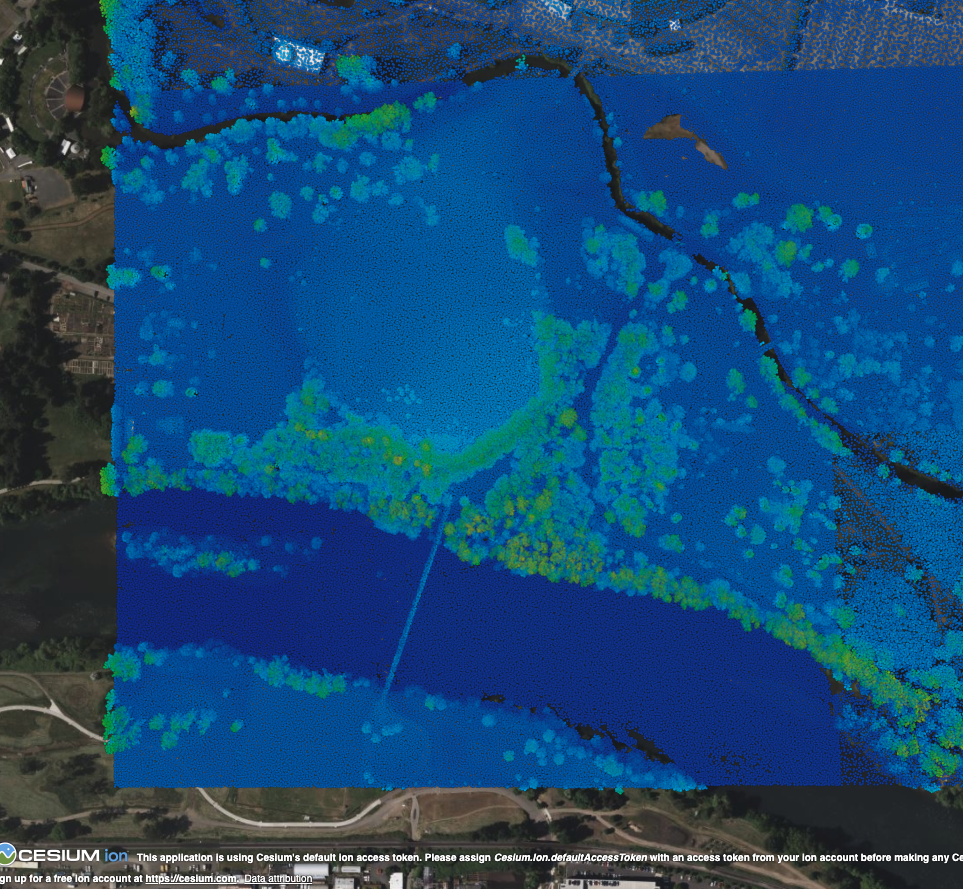<br>Closer view with finer detail.</td>
    </tr>
  </tbody>
</table>

These captures use different camera viewpoints and illustrate behavior rather
than a same-camera benchmark. The renderer selects point detail according to
the active camera view and node/point resource budgets.

Camera movement changes hierarchy discovery and selection. With a valid
perspective camera, hierarchy queries follow a conservative envelope of the
active view (including oblique views) rather than a box centered only on the
camera position. Callers without a usable perspective view retain a finite
camera-based fallback. Cached hierarchy pages are reused as the view changes.

The selector maintains a visible coarse frontier and replaces nodes with finer
data when screen-space error, view relevance, hysteresis, and node/point
workload limits permit it. Replacements preserve coarse coverage until finer
data is ready, while newer camera generations supersede stale asynchronous
work. See the [streaming validation report](docs/benchmarks/issue-68-streaming.md),
[architecture guide](docs/ARCHITECTURE.md), and [API documentation](docs/API.md)
for the ownership boundary and current options.

### Point Selection

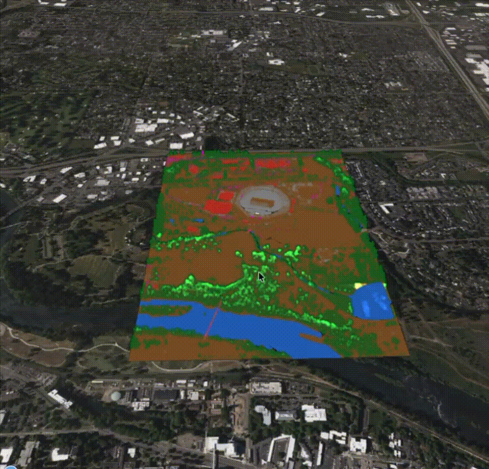

Both adapters expose point picking: Cesium uses `onPointPicked` or
`getSelectedPoint()`, and Three.js uses `pick({ x, y })`. The hit includes its
`{ nodeKey, pointIndex }` identity and requested decoded attributes when
available.

### CesiumJS and Three.js

The preview above shows the CesiumJS adapter. The image below shows the
Three.js adapter; both renderer-specific adapters reuse the shared COPC
streaming Core while the application owns its viewer or scene.

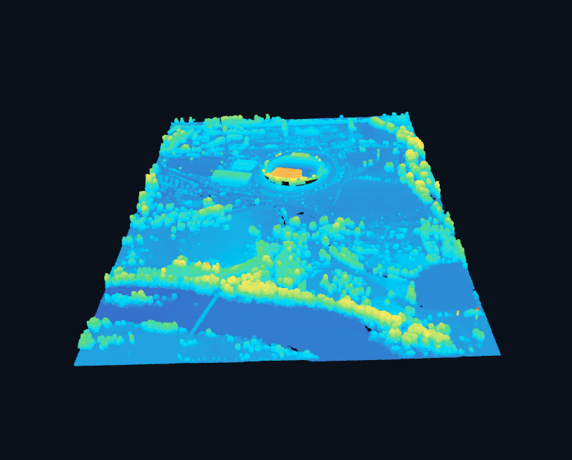

### Experimental 3D Tiles pipeline

The Dev Viewer can also serve COPC nodes as on-demand 3D Tiles content. This
experimental path is separate from the default direct COPC adapters; see the
[3D Tiles demo guide](apps/dev-viewer/docs/3d-tiles-demo.md) for setup and
current limits.

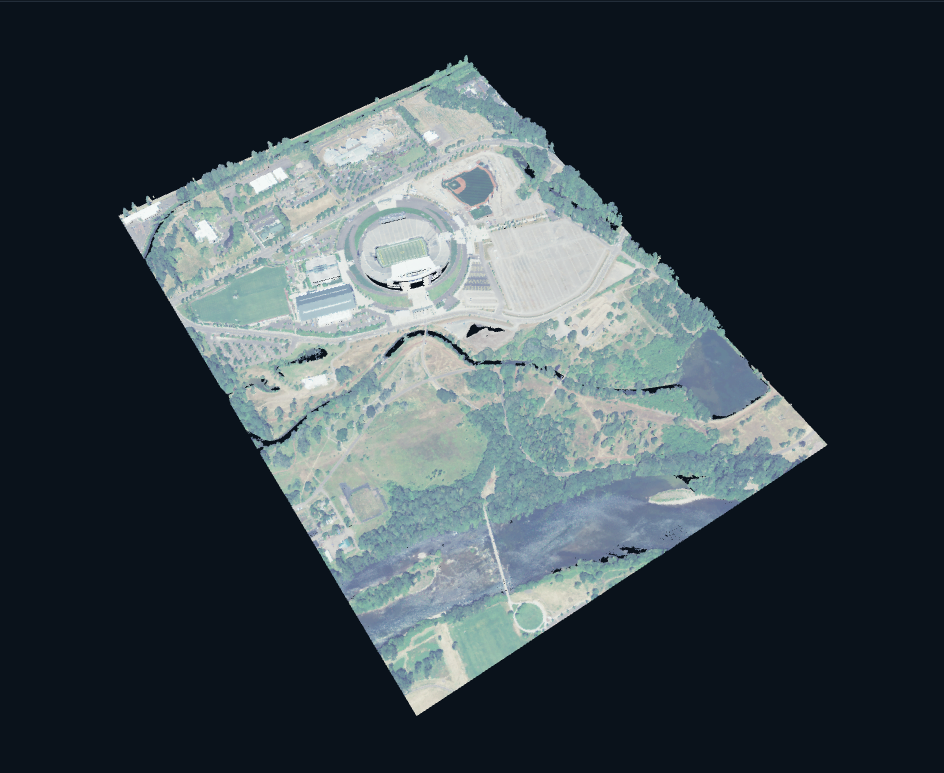

### Korean Public Dataset

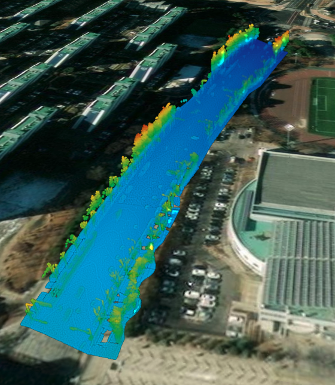

Korean public LAZ dataset converted to COPC and rendered in CesiumJS.

## Documentation

- [한국어 가이드](https://mors119.github.io/copc-adapter/ko/)
- [HTTP Range / CORS hosting guide (EN)](https://mors119.github.io/copc-adapter/source-hosting)
- [HTTP Range / CORS 배포 가이드 (KO)](https://mors119.github.io/copc-adapter/ko/source-requirements)
- [Validation overview](https://mors119.github.io/copc-adapter/ko/validation)
- [Public API](https://mors119.github.io/copc-adapter/API)

## npm Workspaces

The repository contains two independently buildable and publishable npm
packages. The private root workspace owns the single `package-lock.json` used
for package development and validation.

| Package | Directory | Responsibility |
| --- | --- | --- |
| `@frillab/copc-adapter@0.8.0` | [`packages/adapter`](packages/adapter/README.md) | COPC Core, Cesium, and Three entrypoints |
| `@frillab/copc-tiles@0.1.0` | [`packages/tiles`](packages/tiles/README.md) | Source-neutral 3D Tiles engine and optional public Adapter Core connector |

The dependency direction is `@frillab/copc-tiles` →
`@frillab/copc-adapter/core`. Adapter Core and the Tiles Engine do not require
CesiumJS or Three.js. Direct Adapter renderer imports do not import Tiles.
The [architecture guide](docs/ARCHITECTURE.md#workspace-package-boundaries)
and [workspace development guide](docs/monorepo-development.md) describe the
package and consumer boundaries.

## Why COPC Adapter

Many point-cloud workflows look like this:

```text
Point cloud -> preprocessing -> tiling/conversion -> hosting -> visualization
```

COPC Adapter keeps the original COPC resource as the source for both storage
and visualization:

```text
COPC -> HTTP Range requests -> hierarchy / LoD -> point chunks
                                                    ├─ CesiumJS
                                                    └─ Three.js
```

It is a focused browser-side path for applications that want to stream COPC
data without a separate conversion step.

COPC Adapter reads the original COPC resource through HTTP Range requests and
renders selected point chunks through the chosen renderer adapter while the
application retains ownership of its viewer or scene. The
`@frillab/copc-adapter/core` package subpath also exposes a renderer-neutral
COPC source for applications that provide their own node scheduler and output
format; it does not build 3D Tiles content. The `./core` export is available
from version 0.7.0; version 0.6.0 does not include it. See the
[source API](https://mors119.github.io/copc-adapter/API#copc-tiles-compatibility-audit)
for its contract and limits.

## Features

- Direct COPC streaming from a browser-readable URL or local `File`/`Blob`
- HTTP Range random access and recursive hierarchy traversal
- Incremental view-driven hierarchy loading with perspective frustum filtering
- Coverage-preserving mixed-LoD streaming with screen-space-error refinement
- Bounded node/point workload and decoded-point cache
- Selectable foveated or screen-projection refinement with LoD hysteresis
- Runtime Cesium screen-circle Focus Lens with bounded refinement pressure
- Bounded current-view refinement lookahead for recent camera rotation
- Coverage-safe asynchronous coarse/fine renderer transitions
- CesiumJS rendering through a caller-owned `Viewer`
- Three.js rendering through a caller-owned scene and render loop
- Stable `copc-js` backend and opt-in Rust/WASM backend
- Fixed, RGB, elevation, intensity, classification, and numeric dimension styling
- Typed TypeScript API and explicit layer lifecycle
- Public point picking with a compact node/index identity and demo inspector
- Packed npm artifact with declarations and decoder runtime assets

## Quick Start: CesiumJS

Install the package and the Cesium version owned by your application:

```bash
npm install @frillab/copc-adapter cesium
```

```ts
import * as Cesium from 'cesium';
import { CopcCesiumLayer } from '@frillab/copc-adapter/cesium';

const viewer = new Cesium.Viewer('cesium-container');
const layer = new CopcCesiumLayer({
  url: 'https://example.com/data.copc.laz',
});

await layer.load();
layer.attachTo(viewer);
```

The caller owns the Cesium `Viewer` and is responsible for destroying it.
For local COPC, pass a browser `File` or `Blob` as `url`; the adapter reads
only requested byte slices and does not upload the file. Ordinary LAS/LAZ
without COPC hierarchy metadata is unsupported.
With no appearance options, points use the fixed cyan color and 3-pixel size.

The historical root import remains supported for existing Cesium consumers:

```ts
import { CopcCesiumLayer } from '@frillab/copc-adapter';
```

The supported renderer imports are:

```ts
import { CopcCesiumLayer } from '@frillab/copc-adapter';
import { CopcCesiumLayer } from '@frillab/copc-adapter/cesium';
import { CopcThreeLayer } from '@frillab/copc-adapter/three';
```

### Three.js package boundary

Three.js consumers should import the isolated renderer entrypoint rather than
the backwards-compatible Cesium root entrypoint:

```bash
npm install @frillab/copc-adapter three
```

```ts
import * as THREE from 'three';
import {
  CopcStreamingCore,
  createPerspectiveViewFrustum,
} from '@frillab/copc-adapter/three';
```

`@frillab/copc-adapter/three` has no static Cesium module dependency. The
package keeps both renderer peers optional because one package serves both
entrypoints; applications install the renderer they use. The Three.js façade
is available from the isolated `./three` export. It uses a
fixed dataset-local ENU frame (`+X` east, `+Y` north, `+Z` up) for both camera
views and rendered points, while the application retains ownership of the
scene, camera, WebGL renderer, and render loop. See the [package boundary
architecture](docs/ARCHITECTURE.md#package-boundary) and the original
[Issue #139 decision](https://github.com/mors119/copc-adapter/issues/139).

```ts
import * as THREE from 'three';
import { CopcThreeLayer } from '@frillab/copc-adapter/three';

const scene = new THREE.Scene();
const camera = new THREE.PerspectiveCamera(45, 1, 0.1, 20_000);
const renderer = new THREE.WebGLRenderer();
const layer = new CopcThreeLayer({
  url: 'https://example.com/data.copc.laz',
});

await layer.load();
layer.attachTo({ scene, camera, renderer });

function animate() {
  requestAnimationFrame(animate);
  void layer.update();
  renderer.render(scene, camera);
}
animate();
```

Three.js uses the same fixed cyan color and 3-pixel size by default. Its
`url` option also accepts a browser `File` or `Blob`.

`layer.pick({ x, y })` accepts normalized device coordinates and resolves the
hit through the live decoded buffer. `pickingThreshold` is in scene units and
defaults to one metre. `layer.detachFrom()`, `layer.unload()`,
`layer.reload()`, and `layer.destroy()` release only resources owned by the
layer; they never dispose the application renderer or scene.

For the Cesium façade, destroying the layer does not destroy the viewer:

```ts
layer.detachFrom();
layer.destroy();
viewer.destroy();
```

The decoded point cache is bounded by `maxPointCacheBytes` (256 MiB by
default), in addition to its node-count safety cap. Its diagnostics count the
actual `TypedArray.byteLength` values for cached project-owned coordinates and
attributes. They represent decoded CPU point-buffer memory, not exact browser,
Cesium, or GPU memory:

```ts
console.log(layer.getPointCacheDiagnostics());
```

Cesium and Three layers default to compact E retained storage: 32 bytes of
ECEF and prepared-height coordinates per point, before requested attributes.
Picked points derive longitude/latitude from ECEF and omit source XYZ. Set
`coordinateCacheLayout: 'A'` to retain the exact Source and Geographic arrays
for synchronous inspection. The public `CopcStreamingCore` keeps its existing
A-shaped contract. E reduces retained cache bytes; current decoders still
prepare A-shaped coordinates before the layer compacts them, so Worker transfer
and transient preparation memory are unchanged.

The compatibility renderer uses Cesium's default `scene.pick` window. The
opt-in batched renderer requests a 1×1 pick sample so CPU refinement uses the
same deterministic pixel rather than Cesium's undocumented 3×3 traversal
order. Both resolve the project-owned `{ nodeKey, pointIndex }` identity
through the current decoded node buffer. Use
`onPointPicked` or `layer.getSelectedPoint()` after a click to read transformed
position/height, retained source XYZ, and RGB/intensity/classification when
those fields were requested and decoded. Missing fields remain unavailable,
and picking never forces full-field decoding. The demo opens a point popover
anchored beside the selected point.

HTTP COPC sources must support Range requests and return exact `206` partial
responses. The default `rangeValidation: 'head-fallback'` policy validates a
readable `Content-Range` and uses a readable `HEAD` size only when JavaScript
cannot read that header. Because `HEAD` cannot prove the returned byte offset,
expose `Content-Range` for strict validation. Set
`rangeValidation: 'strict'` to require that header and fail when it is
unavailable. The fallback checks exact response length and detectable resource
changes, but HTTP metadata is not cryptographic data integrity. Cross-origin
sources need CORS permission for the consuming origin; the fallback also needs
the browser to permit `HEAD` and read `Content-Length`. Local `File`/`Blob`
inputs and caller-provided random-access sources do not use this HTTP policy.
See the [HTTP Range / CORS hosting guide](https://mors119.github.io/copc-adapter/source-hosting)
for provider settings and end-to-end checks.

### Diagnose a COPC source

COPC stores hierarchy pages and compressed point chunks at different byte
offsets, so browser streaming needs reliable random access. Use the small
project-owned probe before reporting a load failure:

```ts
import { probeCopcSource } from '@frillab/copc-adapter';

const source = await probeCopcSource('https://example.com/data.copc.laz');
console.table(source);
```

The probe requests only bytes `0-1023`, reads a bounded response prefix, and
may request the remainder of the LAS VLR area when that metadata is not in the
first prefix. It does not download the whole file and uses the same default
validation policy as the layers. A healthy result has `reachable: true`,
`rangeSupported: true`, HTTP `206`, `copcDetected: true`, and a
`validationLevel` of `strict` or `compatibility-limited`. The compatibility
level means `Content-Range` was not readable and byte-offset correctness could
not be established. `pointFormat` is the LAS point data record format when the
header is observable.

`rangeSupported: false` means the browser observed an unusable response, such
as HTTP `200` when the server ignored Range, a mismatched `Content-Range`, or a
short body. `corsReadable: true` means fetch returned an inspectable response,
not that every response header is readable. Check `contentRange` directly. A
browser fetch failure can be caused by CORS, DNS, TLS, an offline client, or
another network condition, so the probe reports that state as `unknown` and
suggests checking both network availability and CORS policy.

Range and CORS are separate concerns: a response can be CORS-readable but
still return `200` or invalid partial content, and a server can implement
correct ranges while the browser is unable to read them cross-origin. Common
deployment problems include an object-storage gateway, CDN, or reverse proxy
stripping the `Range` request, converting `206` to `200`, changing
`Content-Range`, or omitting the CORS rule for the application origin, an
actually requested preflight header, or exposed `Content-Range`. The server
should preserve the requested byte range, return exactly that body, and make
`Content-Range` readable to the browser.

The development viewer runs this probe once when its debug panel is enabled
and displays reachability, Range/206, CORS observability, COPC detection, point
format, and warnings. Normal `CopcCesiumLayer.load()` does not add a separate
diagnostic request.

## Rust / WASM Backend

`copc-js` is the stable default backend. Rust/WASM is opt-in and experimental:

```ts
const layer = new CopcCesiumLayer({
  url: 'https://example.com/data.copc.laz',
  backend: 'rust',
});
```

Both backends use the same public layer, renderer-neutral streaming, and
prepared-point contract. Rust/WASM does not create or own a viewer or scene.
In the Rust streaming path, each Worker initializes reusable dataset CRS/LAZ state
and prepares one node's source/geographic/ECEF buffers, requested attributes,
and point statistics in one job. `decodeDurationMs` and
`pointPreparationDurationMs` are reported separately; the JS path remains the
reference implementation and is not silently used as a Rust fallback.
The Rust CRS path covers the validated supported WKT/CRS matrix only; full
PROJ and vertical-datum parity is not implied.

Both layers accept `heightOffsetMeters` for a caller-supplied additive
ellipsoidal-height correction. It defaults to `0` and is applied after
vertical-unit conversion, before ECEF preparation. This is a manual correction
only: it does not perform a geoid or vertical-datum conversion, sample terrain,
or assume a universal offset for Korean datasets or any other region. Picked
point `source.z` remains the original source value; `height` and `world` report
the corrected display position.

## Architecture

COPC Adapter has a shared browser streaming core and thin renderer adapters.
The current implementation uses `copc-js` by default and an opt-in Rust/WASM
backend. TypeScript owns browser Range I/O, view/LoD policy, and the copc-js
reference preparation path; Rust streaming uses its fused decode/CRS/ECEF
preparation result. CesiumJS and Three.js consume the shared prepared data
while the application retains ownership of its viewer or scene.

See the [architecture guide](docs/ARCHITECTURE.md) for current ownership,
target processing architecture, and migration invariants.

## Public API and Lifecycle

With a caller-owned `viewer` and a configured `layer`, the lifecycle is:

```ts
import { CopcCesiumLayer } from '@frillab/copc-adapter';

await layer.load();
layer.attachTo(viewer);

layer.detachFrom();
await layer.reload();
layer.unload();
layer.destroy();

const snapshot = layer.getSnapshot();
const metadata = layer.getMetadata();
```

See [API documentation](docs/API.md) for options, backend boundaries, point
fields, errors, and lifecycle details.

## Development

Requirements: Node.js 22 or later (the CI version) and a Rust toolchain with the
`wasm32-unknown-unknown` target.

```bash
npm run setup
npm run dev
```

Setup installs dependencies, prepares the existing WASM assets and Chromium,
and downloads Autzen with its configured size and SHA-256 checks. The viewer
serves `samples/local` through its same-origin HTTP Range middleware. These
commands run the repository's development viewer; they do not change or
publish the released npm package.

To check the eight core behaviors in the same default Viewer, run:

```bash
npm run test:functional
```

Core validation commands:

```bash
npm run typecheck -w @frillab/copc-adapter
npm test -w @frillab/copc-adapter
npm run coverage -w @frillab/copc-adapter
npm run build -w @frillab/copc-adapter
npm run typecheck -w @frillab/copc-tiles
npm run typecheck:adapter-core -w @frillab/copc-tiles
npm test -w @frillab/copc-tiles
npm run build -w @frillab/copc-tiles
npm run test:packed-consumer -w @frillab/copc-tiles
npm run test:functional
npm --prefix apps/dev-viewer run test:e2e
npm run benchmark:renderer -w @frillab/copc-adapter
npm run benchmark:vertical-grid -w @frillab/copc-adapter
npm --prefix apps/dev-viewer run benchmark:streaming
npm --prefix apps/dev-viewer run benchmark:vertical-grid
npm --prefix apps/dev-viewer run test:e2e -- e2e/renderer-performance.spec.ts
npm run test:pack
cargo test --workspace
```

To pack each distribution separately, without publishing:

```bash
npm pack --workspace @frillab/copc-adapter --pack-destination /tmp/copc-adapter-pack
npm pack --workspace @frillab/copc-tiles --pack-destination /tmp/copc-tiles-pack
```

Each package keeps its own version, exports, files list, and npm artifact.
Builds clean their own `dist`; Adapter includes its decoder runtime assets,
Tiles includes its package documentation, and neither tarball includes the
other package's source or local COPC datasets. The public Playground continues
to install the exact published Adapter `0.7.1`; the Dev Viewer links the local
workspace package. See [workspace development](docs/monorepo-development.md)
for candidate-package and released-package checks.

`npm run test:pack` is the release-boundary gate for the generated `.tgz`. It
builds Rust/WASM and the library, checks the tarball contents, installs it by
package name into a disposable external Vite + Cesium consumer, builds and
previews that consumer, and runs Chromium against the production bundle. The
consumer verifies HTTP 206/Range traffic, package-local decoder assets,
incremental hierarchy diagnostics, Rust backend selection without fallback,
coordinate/attribute rendering, and continued `copc-js` operation. Its
checked-in template is in `tests/environments/cesium-vite/`; the sample is
staged only into the disposable consumer and is never packaged.

## Known Limitations

These are the current boundaries:

### Three.js current boundaries

The Three.js entrypoint is a composable layer for an existing application,
not a full point-cloud viewer. The current adapter does not implement:

- `OrthographicCamera` support; the validated camera is
  `THREE.PerspectiveCamera`.
- EDL, measurements, profiles, annotations, clipping, or viewer UI.
- React Three Fiber, Babylon.js, or WebGPU adapters.
- Moving-origin/rebasing, arbitrary root transforms into an application
  coordinate frame, or a custom shader-extension framework.

The dataset-local ENU frame is fixed for the lifetime of a loaded dataset.
The application remains responsible for the scene, camera, WebGL renderer,
controls, render loop, and UI.

- Hierarchy loading starts with the root page and follows only relevant
  intersecting pages for the current project-coordinate bounds and target
  level; broader hierarchy/loading optimization remains future work.
- LoD uses adapter-owned screen-space error with bounds/frustum filtering,
  mixed-LoD coverage, gaze-aware priority, hysteresis, and node/point safety
  caps; occlusion culling is not implemented yet.
- Browser Rust/WASM point preparation uses a bounded worker pool when `Worker`
  is available; environments without workers use the same `copc-adapter-core`
  semantics on the main thread. Worker queue/concurrency diagnostics are
  exposed in snapshots. The thread-ownership audit and camera-input evidence
  are in the [Worker responsiveness
  report](docs/benchmarks/issue-208-worker-responsiveness.md).
- Rendering uses the compatibility `PointPrimitiveRenderer` boundary backed by
  `Cesium.PointPrimitiveCollection`; coverage-safe transitions keep old
  coverage until a replacement is ready. `BatchedGeometryPointRenderer` is an
  explicit Cesium entrypoint opt-in, with conservative CPU refinement for
  point-level picks; ambiguous overlaps clear selection. It has been browser
  validated with Cesium 1.142.0 and 1.146.0. Point identity resolution is
  currently limited to 3D scene mode. Benchmark evidence is in the
  [renderer benchmark](docs/benchmarks/issue-48-renderer.md).
- Dense refinement workloads can take time to finish progressively. The
  priority scheduler keeps range/decode/preparation work bounded, emits each
  ready node independently, yields between completions, and discards stale
  generations. Rendered-point budget/backpressure remains separate from load
  concurrency. See the [streaming validation report](docs/benchmarks/issue-68-streaming.md).
- The Rust backend currently targets the supported LAS 1.4 point format
  subset, including point formats 6, 7, and 8.
- Source URLs must support HTTP Range requests and appropriate CORS behavior.

## Roadmap

See the [project roadmap](docs/ROADMAP.md) for capability-based development
stages and remaining goals. Historical measurements remain in
[`docs/benchmarks/`](docs/benchmarks/).

## Related Documentation

- [Architecture](docs/ARCHITECTURE.md)
- [API](docs/API.md)
- [Examples](docs/EXAMPLES.md)
- [Conformance](docs/CONFORMANCE.md)
- [Cesium contest functional-test runbook](docs/CONTEST-FUNCTIONAL-TEST.md)
- [Roadmap](docs/ROADMAP.md)
- [Sample datasets](samples/README.md)
- [Contributing](CONTRIBUTING.md)

## Community and License

- [Contributing guide](CONTRIBUTING.md)
- [Code of Conduct](CODE_OF_CONDUCT.md)
- [Security policy](SECURITY.md)
- [Support](SUPPORT.md)

COPC Adapter is released under the [Apache License 2.0](LICENSE).
