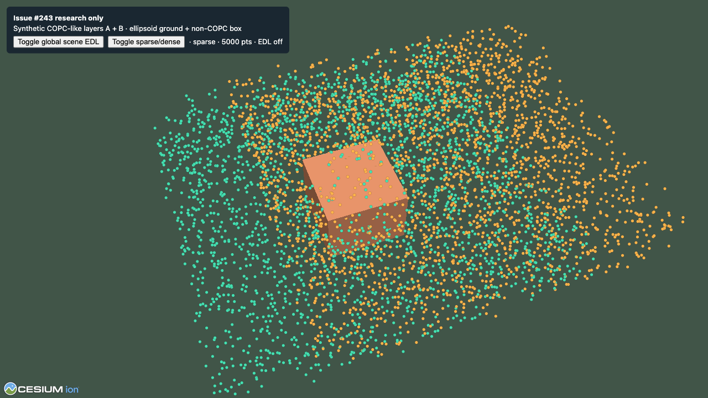
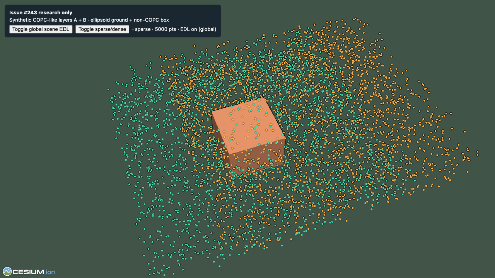

# Issue #243: Point-cloud-only EDL research

**Decision:** Defer a production EDL option. Cesium 1.142.0 exposes EDL for its
3D Tiles point-cloud renderer, but the COPC adapter renders through
`PointPrimitiveCollection` or `Primitive`; that public EDL path does not accept
either renderer. The public `PostProcessStage` alternative reads scene-wide
color and depth, so it changes terrain and other Cesium objects too. It cannot
meet the point-cloud-only acceptance criteria.

This is a research result, not a production implementation. No default,
renderer, schema, Workbench, or public API changed. A production feature issue
is not warranted until Cesium exposes a supported per-layer render/depth hook
or the adapter has a separately supported renderer integration point.

## Versions and test setup

| Item | Version / environment |
| --- | --- |
| Cesium public consumer baseline | `1.142.0` in `tests/environments/cesium-vite/package.json`; `@cesium/engine` resolves to `26.0.0` |
| Browser benchmark Cesium | `1.146.0`, locked by `apps/dev-viewer/package-lock.json` |
| Three.js | `0.186.0` in the Dev Viewer lockfile |
| Potree source comparison | `develop` at `5636cd471d9eb464969e758be45c44d7613d3859` |
| Browser / GPU | Chrome `156.0.8078.74`, macOS host, WebGL 2, ANGLE Metal on Apple M2 |
| WebGL limits reported by Chrome | `MAX_TEXTURE_SIZE=16384`, `MAX_RENDERBUFFER_SIZE=16384`, 8 color attachments, 8 draw buffers |
| WebGL 1 capability probe | 30 varying vectors; `EXT_frag_depth`, `OES_texture_float`, and `WEBGL_draw_buffers` present |

The exact Cesium 1.142.0 API/source was checked through the pinned engine
package. The visual and performance probe ran with the current Dev Viewer lock
at Cesium 1.146.0; these timings are not a claim about every supported Cesium
version or GPU.

## API and renderer comparison

| Path | What it supports | Why it does or does not fit COPC |
| --- | --- | --- |
| Cesium `PointCloudShading` | Public `eyeDomeLighting`, `eyeDomeLightingStrength`, `eyeDomeLightingRadius`, and `isSupported(scene)`. On the tileset path, EDL is run when point attenuation and EDL are enabled. | It is wired into Cesium's 3D Tiles point-cloud command generation. The engine makes an offscreen color/depth target from those point commands, then composites it with depth/stencil state. The adapter's point primitive and batched geometry paths do not enter that pipeline. Calling a global stage does not make them eligible. |
| Cesium `PostProcessStage` | Public custom fragment shader with the rendered scene's `colorTexture` and `depthTexture`; `textureScale` can lower target resolution. | Its color/depth inputs cover the rendered scene. `selected` is feature selection, not a render target for a caller-owned primitive collection. Running EDL here also shades terrain, buildings, and unrelated primitives. |
| Potree EDL renderer | Its renderer draws managed point clouds to an EDL color/depth target, runs a neighbor-depth shader, and composites the result in its render pipeline. Multiple Potree point clouds share that point-cloud pass. | This is a renderer-owned multi-pass path. It does not provide a drop-in Cesium pass for COPC primitives. Potree's WebGL 1 feature check looks for `EXT_frag_depth`, `OES_texture_float`, and at least 8 varying vectors; unsupported hardware needs EDL left off. |
| Three.js `0.186.0` | `WebGLRenderTarget`, `WebGLRenderer.setRenderTarget`, and explicit render calls provide public primitives for custom passes. Three's `WebGLRenderer` uses WebGL 2 (WebGL 1 support ended at r163). | A caller could render the COPC root separately, but this adapter does not own the application's renderer or frame loop. A correct feature would need caller-owned render-pipeline integration and a plan for preserving depth occlusion from other scene objects. There is no built-in adapter EDL path. |

Cesium's 1.142 source also documents the WebGL 1 EDL requirements (`EXT_frag_depth`,
`OES_texture_float`, and `WEBGL_draw_buffers`). Its public support query is the
fallback gate. If the private tileset EDL processor finds support missing, it
returns without running EDL. Cesium's internal EDL processor documents that
per-point translucency is unsupported, although translucent styling against
the globe is supported. That is a mismatch for an adapter that supports point
alpha and layer opacity.

## Probe and screenshots

The research-only route is [edl-research.html](../../apps/dev-viewer/edl-research.html)
with its [probe source](../../apps/dev-viewer/src/experimental/edlResearchProbe.ts).
It renders two deterministic point collections as COPC-like layer stand-ins,
an ellipsoid ground, and an opaque non-point box. Its custom four-neighbor EDL
shader is attached as a **global** `PostProcessStage`, specifically to test
the public-stage boundary. The EDL control is confined to this research page.

The shader uses strength `18` and radius `2` to make the edge effect visible;
these are demonstration settings, not recommended production settings. The
fixture uses opaque points and no imagery or external terrain provider. It is
not an adapter streaming or real-COPC test.

To open the standalone probe with the Dev Viewer dependencies installed, run
`npx vite --host 127.0.0.1 --port 4177` from `apps/dev-viewer` and navigate to
`/edl-research.html`. The browser console exposes
`window.__EDL_RESEARCH__.measureGpu(enabled, 5000)` and
`measureFrames(enabled, 5000)` for paired samples, with `enabled` set to either
`false` or `true`.

| Global stage off | Global stage on |
| --- | --- |
|  |  |

The probe applies to both point layers and receives the same scene depth that
contains the box and ellipsoid. It therefore demonstrates the main limitation:
the public stage has no COPC-only depth target. This synthetic setup does not
validate two real adapter layers, real terrain tiles, imagery, or translucent
point composition. Those cases remain deferred because the stage cannot
isolate the COPC layer in the first place.

## Measured cost

Method: warm the scene for 2 seconds, then collect 5 seconds of full-scene GPU
timer queries and `requestAnimationFrame` intervals for each stage state. GPU
queries use `EXT_disjoint_timer_query_webgl2`; all runs reported `disjoint=false`.
The only scene change between paired samples was adding/removing the global
stage. Values below are p50 and p95 milliseconds from one run, with 300 samples
per case at DPR 1. At DPR 2, the sparse case used 240 samples per stage state.

| Synthetic points | Viewport / drawing buffer | GPU p50 off → on | GPU p95 off → on | Frame interval p50 off → on | Frame interval p95 off → on |
| ---: | --- | ---: | ---: | ---: | ---: |
| 5,000 (2 × 2,500) | 1280×720 CSS / 1280×720 px, DPR 1 | 3.302 → 3.770 ms (+0.468, +14.2%) | 3.878 → 4.436 ms (+0.558, +14.4%) | 16.7 → 16.7 ms | 17.3 → 17.7 ms |
| 100,000 (2 × 50,000) | 1280×720 CSS / 1280×720 px, DPR 1 | 5.578 → 6.363 ms (+0.786, +14.1%) | 6.205 → 6.784 ms (+0.579, +9.3%) | 16.7 → 16.7 ms | 17.7 → 17.6 ms |
| 5,000 (2 × 2,500) | 1280×720 CSS / 2560×1440 px, DPR 2 | 10.197 → 11.396 ms (+1.199, +11.8%) | 12.413 → 13.400 ms (+0.987, +8.0%) | not sampled | not sampled |

These are full-frame GPU times, not isolated shader timings. The paired delta
approximates the added stage cost for this scene. At DPR 1, the frame interval
remained near the browser's 60 Hz cadence; the GPU timer exposed the added work
that the frame interval hid. Dense/sparse point count changed the base scene
cost, while the extra EDL work was primarily viewport-sized.

The WebGL test surface reported a 16384 maximum texture/renderbuffer size. A
single RGBA8 output at 1280×720 is about 3.52 MiB; at 2560×1440 it is about
14.06 MiB. This is a per-target estimate only. WebGL exposes no standard live
GPU-memory counter, and Cesium's internal ping-pong/framebuffer allocations
were not measured. Actual peak memory is higher and depends on its render
pipeline.

At DPR 2 with `useBrowserRecommendedResolution: false`, Cesium resized the
drawing buffer from 2560×1440 to 1800×1200 after changing the CSS viewport from
1280×720 to 900×600. The probe's viewport-relative neighbor offsets followed
the resize. This verifies the custom global stage's resize behavior only; it
does not prove the adapter has a supported per-layer target.

## Decision and remaining evidence

- **Cesium:** no-go for a supported COPC-only EDL feature with the current
  public rendering surface. Reusing the private 3D Tiles EDL processor would
  depend on Cesium internals; a global stage violates object isolation.
- **Two COPC layers / terrain:** their correctness in a layer-isolated pass was
  not established. The public path has no layer-only depth target, so the
  required multi-layer and mixed terrain behavior cannot be claimed.
- **Transparency:** the native Cesium EDL path documents a per-point alpha
  limitation. The custom global probe used opaque points only.
- **GPU / memory scope:** one Apple M2 and one Chrome build only; no mobile,
  low-end, actual WebGL 1 rendering, or browser-without-timer-query run. A
  WebGL 1 context capability probe confirmed the required extensions on this
  host. Memory is estimated from target dimensions, not read from GPU telemetry.
- **Next step:** do not expose an EDL setting. Revisit only with a supported
  per-layer Cesium target hook (or an app-owned Three render-pipeline contract),
  then test real adapter layers, terrain/imagery overlap, alpha, and fallback
  browsers before opening an implementation issue.

The main application has no EDL control and its rendering defaults are
unchanged. The standalone global-stage probe intentionally modifies every
object represented by its scene depth; that result fails the object-isolation
criterion and is not an adapter feature.

## References

- Cesium 1.142.0 [`PointCloudShading`](https://github.com/CesiumGS/cesium/blob/1.142/packages/engine/Source/Scene/PointCloudShading.js), [`Cesium3DTileset`](https://github.com/CesiumGS/cesium/blob/1.142/packages/engine/Source/Scene/Cesium3DTileset.js), and private [`PointCloudEyeDomeLighting`](https://github.com/CesiumGS/cesium/blob/1.142/packages/engine/Source/Scene/PointCloudEyeDomeLighting.js) source.
- Cesium public [`PointCloudShading` API](https://cesium.com/learn/cesiumjs/ref-doc/PointCloudShading.html), [`PostProcessStage` API](https://cesium.com/learn/cesiumjs/ref-doc/PostProcessStage.html), and [`Scene.postProcessStages`](https://cesium.com/learn/cesiumjs/ref-doc/Scene.html).
- Potree [`EDLRenderer`](https://github.com/potree/potree/blob/5636cd471d9eb464969e758be45c44d7613d3859/src/viewer/EDLRenderer.js), [`EDL shader`](https://github.com/potree/potree/blob/5636cd471d9eb464969e758be45c44d7613d3859/src/materials/shaders/edl.fs), and [`WebGL feature checks`](https://github.com/potree/potree/blob/5636cd471d9eb464969e758be45c44d7613d3859/src/Features.js).
- Three.js [`WebGLRenderer`](https://threejs.org/docs/pages/WebGLRenderer.html) and [render target guide](https://threejs.org/manual/pages/rendertargets.html).
